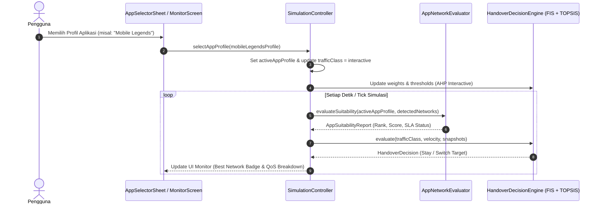

# Spesifikasi Rekomendasi Jaringan Berbasis Aplikasi Spesifik (QoS & SLA Mapping)

Dokumen ini merupakan dasar ilmiah, teknis, dan standar telekomunikasi resmi untuk modul **Penentu Jaringan Terbaik untuk Aplikasi Spesifik (*App-Specific Network Recommender*)** pada proyek WMC Handsign.

---

## 1. Landasan Ilmiah & Standar Telekomunikasi Acuan

Pemetaan kebutuhan jaringan untuk aplikasi spesifik mengacu pada kombinasi standar internasional dan literatur ilmiah terindeks:

1. **3GPP TS 23.107 / TS 23.501 — *Quality of Service (QoS) Architecture***:
   - Standar konsorsium 3GPP yang membagi seluruh layanan data seluler (UMTS, 4G LTE, dan 5G NR) ke dalam empat kelas trafik kanonis:
     - **Conversational Class**: Karakteristik *real-time*, waktu tunda (*delay*) sangat ketat, transfer data dua arah simetris/hampir simetris (contoh: VoIP, video call).
     - **Streaming Class**: Karakteristik satu arah kontinu, sensitif terhadap fluktuasi laju data (*jitter*), namun mentoleransi latensi karena adanya penyangga (*playback buffer*).
     - **Interactive Class**: Karakteristik *request-response*, integritas data tinggi, memerlukan latensi wajar agar tidak menurunkan pengalaman interaktif (contoh: *online gaming*, *web browsing*).
     - **Background Class**: Karakteristik transmisi data asinkron tanpa batasan waktu mendesak (contoh: *background sync*, *cloud backup*, unduhan berkas besar).
   - Pemetaan **5G QoS Identifier (5QI)** pada 3GPP TS 23.501 Tabel 5.7.4-1:
     - **5QI 1**: *Conversational Voice* (Paket Delay Budget 100 ms, Packet Error Rate $10^{-2}$).
     - **5QI 3**: *Real-Time Gaming* (Paket Delay Budget 50 ms, Packet Error Rate $10^{-3}$).
     - **5QI 4**: *Non-Conversational Video Streaming* (Paket Delay Budget 300 ms, Packet Error Rate $10^{-6}$).
     - **5QI 8 / 9**: *TCP-based Interactive / Default Internet* (Paket Delay Budget 300 ms, Packet Error Rate $10^{-6}$).

2. **ITU-T Recommendation G.1010 — *End-user Multimedia QoS Categories***:
   - Standar International Telecommunication Union (ITU-T) yang menetapkan batas persepsi kenyamanan manusia (*Quality of Experience / QoE*) terhadap parameter teknis jaringan (latensi satu arah, *throughput*, dan *loss ratio*).
   - Mengelompokkan aplikasi ke dalam matriks batas toleransi indera manusia (audio, video, data).

3. **ITU-T Recommendation G.114 — *One-Way Transmission Time***:
   - Menetapkan batas keterlambatan bicara dua arah:
     - $< 150\text{ ms}$: Kualitas interaktif prima (*High User Satisfaction*).
     - $150 - 400\text{ ms}$: Kualitas interaktif dapat diterima dengan sedikit gangguan interupsi.
     - $> 400\text{ ms}$: Tidak dapat diterima untuk percakapan interaktif normal (*Unacceptable*).

4. **Ndegwa et al. (2023) — *User Preference-Based Heterogeneous Network Management System for Vertical Handover***:
   - [DOI: 10.1155/2023/5551773](https://doi.org/10.1155/2023/5551773) (Hindawi / Wiley).
   - Menetapkan matriks perbandingan berpasangan AHP (*Analytic Hierarchy Process*) untuk menentukan bobot kriteria ($w_{\text{rate}}, w_{\text{delay}}, w_{\text{ber}}$) berdasarkan preferensi kelas aplikasi pengguna, yang kemudian dimasukkan ke dalam algoritma pemeringkatan TOPSIS.

---

## 2. Matriks Pemetaan Aplikasi Populer ke Parameter QoS (SLA)

Berdasarkan sintesis standar 3GPP TS 23.501, ITU-T G.1010, dan Ndegwa et al. (2023), berikut adalah tabel parameter acuan kanonis untuk aplikasi spesifik:

| ID Aplikasi | Nama Aplikasi & Skenario | Kelas Trafik 3GPP | Standar Referensi | Min Data Rate | Target Data Rate | Max Latensi (OWD) | Target Latensi | Max Toleransi BER | Prioritas Kriteria Utama (AHP) |
|---|---|---|---|---|---|---|---|---|---|
| `youtube` | **YouTube / Netflix / TikTok** | *Streaming* | ITU-T G.1010 (Streaming), 3GPP 5QI 4 | $5.0\text{ Mbps}$ (1080p) | $25.0\text{ Mbps}$ (4K HDR) | $350\text{ ms}$ | $\le 100\text{ ms}$ | $1.0 \times 10^{-4}$ | **Data Rate** ($w_1 = 0.72$) |
| `mobile_legends` | **Mobile Legends / PUBG / Gaming** | *Interactive* | ITU-T G.1010 (Gaming), 3GPP 5QI 3 | $1.0\text{ Mbps}$ | $5.0\text{ Mbps}$ | $60\text{ ms}$ | $\le 20\text{ ms}$ | $1.0 \times 10^{-5}$ | **Latensi & BER** ($w_2=0.31, w_3=0.58$) |
| `whatsapp_call` | **WhatsApp Call / Zoom VoIP** | *Conversational* | ITU-T G.114, 3GPP 5QI 1 / 2 | $0.2\text{ Mbps}$ | $2.0\text{ Mbps}$ (HD) | $120\text{ ms}$ | $\le 50\text{ ms}$ | $1.0 \times 10^{-4}$ | **Latensi** ($w_2 = 0.78$) |
| `cloud_download` | **Google Drive / File Transfer** | *Background* | 3GPP 5QI 9, ITU-T G.1010 (Bulk Data) | $10.0\text{ Mbps}$ | $100.0\text{ Mbps}$ | $800\text{ ms}$ | $\le 300\text{ ms}$ | $1.0 \times 10^{-3}$ | **Data Rate & BER** ($w_1=0.15, w_3=0.80$) |
| `social_media` | **Instagram / Web Browsing** | *Interactive* | 3GPP 5QI 8, ITU-T G.1010 (Interactive Data) | $2.0\text{ Mbps}$ | $15.0\text{ Mbps}$ | $200\text{ ms}$ | $\le 80\text{ ms}$ | $1.0 \times 10^{-4}$ | **Campuran Seimbang** |

---

## 3. Formulasi Matematis Evaluasi Kesesuaian Jaringan (App Suitability Score)

Untuk menentukan jaringan mana yang paling cocok bagi aplikasi tertentu di antara alternatif jaringan yang terdeteksi (4G LTE, 5G NR, WLAN), digunakan formulasi **Skor Kesesuaian Multi-Kriteria Terbobot** (*Weighted Application Suitability Score*):

### 3.1. Fungsi Normalisasi Pemenuhan Kriteria ($S_j$)

Setiap parameter jaringan terukur dievaluasi terhadap batas minimum dan target yang diinginkan aplikasi:

1. **Sub-skor Kecepatan Data ($S_{\text{rate}} \in [0.0, 1.0]$)** — *Benefit*:
   $$S_{\text{rate}} = \begin{cases} 
   0.0, & \text{jika } \text{Rate} < \text{MinRate} \\
   \frac{\text{Rate} - \text{MinRate}}{\text{TargetRate} - \text{MinRate}}, & \text{jika } \text{MinRate} \le \text{Rate} < \text{TargetRate} \\
   1.0, & \text{jika } \text{Rate} \ge \text{TargetRate}
   \end{cases}$$

2. **Sub-skor Latensi ($S_{\text{delay}} \in [0.0, 1.0]$)** — *Cost*:
   $$S_{\text{delay}} = \begin{cases}
   1.0, & \text{jika } \text{Delay} \le \text{TargetDelay} \\
   \frac{\text{MaxDelay} - \text{Delay}}{\text{MaxDelay} - \text{TargetDelay}}, & \text{jika } \text{TargetDelay} < \text{Delay} \le \text{MaxDelay} \\
   0.0, & \text{jika } \text{Delay} > \text{MaxDelay}
   \end{cases}$$

3. **Sub-skor Keandalan Bit Error Rate ($S_{\text{ber}} \in [0.0, 1.0]$)** — *Cost (Log-Scale)*:
   $$S_{\text{ber}} = \begin{cases}
   1.0, & \text{jika } \text{BER} \le \text{TargetBER} \\
   \frac{-\log_{10}(\text{BER}) - (-\log_{10}(\text{MaxBER}))}{-\log_{10}(\text{TargetBER}) - (-\log_{10}(\text{MaxBER}))}, & \text{jika } \text{TargetBER} < \text{BER} \le \text{MaxBER} \\
   0.0, & \text{jika } \text{BER} > \text{MaxBER}
   \end{cases}$$

### 3.2. Penggabungan dengan Bobot AHP Ndegwa et al. (2023)

Skor kesesuaian total untuk kandidat jaringan $i$ pada aplikasi $A$ adalah:

$$\text{SuitabilityScore}_i(A) = 100\% \times \left( w_{1, A} \cdot S_{\text{rate}, i} + w_{2, A} \cdot S_{\text{delay}, i} + w_{3, A} \cdot S_{\text{ber}, i} \right)$$

Di mana $\sum_{j=1}^3 w_{j, A} = 1.0$ adalah bobot AHP yang dipetakan sesuai kelas trafik aplikasi $A$.

### 3.3. Status Kelaikan SLA (SLA Compliance Status)

Selain persentase kecocokan numerik, sistem memberikan klasifikasi kualitatif transparan (*explainability*):
- 🟢 **Sangat Direkomendasikan (*Optimal*)**: Skor $\ge 80\%$, seluruh kriteria memenuhi target.
- 🟡 **Cukup / Memadai (*Acceptable*)**: Skor $50\% - 79\%$, memenuhi nilai batas minimum namun belum mencapai target optimal.
- 🔴 **Tidak Disarankan (*SLA Violated*)**: Skor $< 50\%$ atau melanggar *Hard Constraint* (misal latensi game $> 100\text{ ms}$ atau bandwidth video $< 2\text{ Mbps}$).

---

## 4. Alur Integrasi dalam Sistem

---

## 5. Daftar Pustaka Lengkap

1. **3GPP TS 23.501 V18.4.0 (2023-12)**: *System Architecture for the 5G System (5GS); Stage 2 (Release 18)*, 3rd Generation Partnership Project.
2. **3GPP TS 23.107 V17.0.0 (2022-04)**: *Quality of Service (QoS) concept and architecture (Release 17)*, 3rd Generation Partnership Project.
3. **ITU-T Recommendation G.1010 (2001-11)**: *End-user multimedia QoS categories*, International Telecommunication Union, Telecommunication Standardization Sector.
4. **ITU-T Recommendation G.114 (2003-05)**: *One-way transmission time*, International Telecommunication Union, Telecommunication Standardization Sector.
5. **Ndegwa, C., Musyoka, G., & Oduol, V. (2023)**: *User Preference-Based Heterogeneous Network Management System for Vertical Handover*, Wireless Communications and Mobile Computing, vol. 2023, Article ID 5551773, 16 pages. DOI: [10.1155/2023/5551773](https://doi.org/10.1155/2023/5551773).
6. **Alhabo, M., & Zhang, L. (2018)**: *Multi-criteria vertical handover decision-making in heterogeneous wireless networks*, IEEE Access, vol. 6, pp. 61474-61483.
